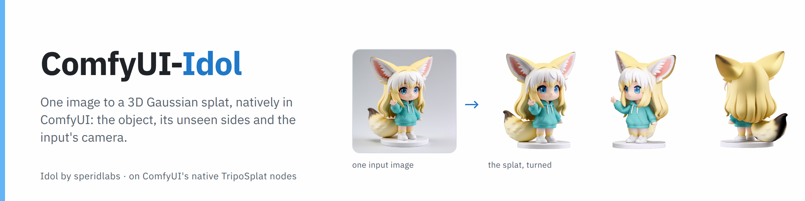
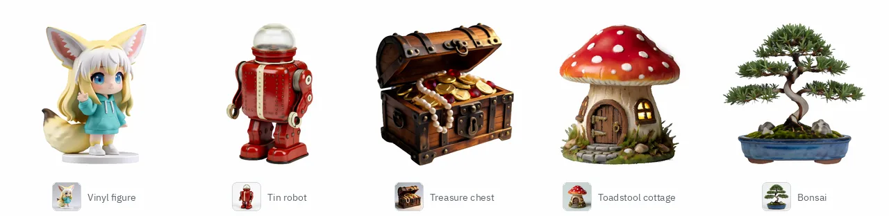

<picture>
  <source media="(prefers-color-scheme: dark)" srcset="assets/banner-dark.png">
  
</picture>

<p align="center">
  
  
  
  
</p>

<p align="center">
  <a href="#quick-start"></a>
  <a href="https://huggingface.co/PedroMarinhoDev/Idol-ComfyUI"></a>
  <a href="example_workflows"></a>
  <a href="https://github.com/speridlabs/idol-sdk"></a>
</p>

Run **[Idol](https://github.com/speridlabs/idol-sdk)** by speridlabs **natively in ComfyUI**: give it one picture of an
object and it builds the whole object as a 3D Gaussian splat (up to 1,048,576 Gaussians), including the sides the picture
never showed. Idol is TripoSplat's architecture with its own weights, so it runs on ComfyUI's own TripoSplat nodes,
KSampler and memory management, not a wrapper around the SDK. This pack adds the three pieces those nodes leave out, and
the converted weights are on Hugging Face as single files.

<picture>
  <source media="(prefers-color-scheme: dark)" srcset="assets/showcase-dark.webp">
  
</picture>

<sub>Idol, <code>idol_fp32</code> at the default precision · 262,144 Gaussians · 50 steps, cfg 4, seed 42 · RTX 3090 · each turntable starts at the input's viewpoint (Idol Input Camera) · inputs made with Krea 2 Turbo from our own prompts</sub>

<table>
  <tr>
    <td width="33%"><br><b>One picture in, the whole object out</b><br>The back and the sides are generated to match the front, as a standard 3DGS <code>.ply</code>.</td>
    <td width="33%"><br><b>ComfyUI's own nodes</b><br>Load Diffusion Model, KSampler, TripoSplat Decode: ComfyUI's memory management, previews and seeds.</td>
    <td width="33%"><br><b>The input's own viewpoint</b><br>Idol predicts where the camera was. Render the object as the picture showed it, or a turntable that starts there.</td>
  </tr>
  <tr>
    <td><br><b>Renders and photos</b><br>Idol's two framings: <code>synthetic</code> for renders and generated images, <code>real</code> for photographs.</td>
    <td><br><b>fp32 when you want it</b><br>fp16 by default; the full-precision model, or fp32 with fp16 attention, from one node.</td>
    <td><br><b>Up to a million Gaussians</b><br>262,144 by default, any multiple of 32 from 32,768 to 1,048,576, set on TripoSplat Decode.</td>
  </tr>
</table>

## Quick start

1. **Install the nodes** and restart ComfyUI. Search for **Idol (image to 3D splat)** in ComfyUI-Manager, or install it
   from the [Comfy Registry](https://registry.comfy.org/nodes/comfyui-idol) with `comfy node install comfyui-idol`. Or
   clone it into `custom_nodes`. There's nothing to `pip install`.

   ```bash
   cd ComfyUI/custom_nodes
   git clone https://github.com/PedroMarinhoDev/ComfyUI-Idol
   ```

2. **Download the files.** The Idol files come from
   [PedroMarinhoDev/Idol-ComfyUI](https://huggingface.co/PedroMarinhoDev/Idol-ComfyUI); the image encoders and the
   background remover are the ones ComfyUI's TripoSplat template uses, from
   [VAST-AI/TripoSplat](https://huggingface.co/VAST-AI/TripoSplat). If you run TripoSplat already, you have those.

   | File | Folder | Size |
   |---|---|---|
   | `idol_fp32.safetensors` | `models/diffusion_models` | 1.48 GB |
   | `idol_vae_decoder_fp32.safetensors` | `models/vae` | 1.15 GB |
   | `dino_v3_vit_h.safetensors` | `models/clip_vision` | 1.68 GB |
   | `flux2-vae.safetensors` | `models/vae` | 0.34 GB |
   | `birefnet.safetensors` | `models/background_removal` | 0.44 GB |

   ```bash
   cd ComfyUI/models
   hf download PedroMarinhoDev/Idol-ComfyUI diffusion_models/idol_fp32.safetensors vae/idol_vae_decoder_fp32.safetensors --local-dir .
   hf download VAST-AI/TripoSplat clip_vision/dino_v3_vit_h.safetensors vae/flux2-vae.safetensors background_removal/birefnet.safetensors --local-dir .
   ```

   The workflow also lists every file with its link, so ComfyUI offers to download what's missing when you open it.

3. **Open the workflow and run.** In ComfyUI, **Templates → ComfyUI-Idol → idol_image_to_splat** (or drag
   [`example_workflows/idol_image_to_splat.json`](example_workflows/idol_image_to_splat.json) in). Pick your image in
   **Load Image** (`example_inputs/fennec-figure.png` is the figure above) and run. You get the `.ply` in `output/3d`, a render from the input's viewpoint and a turntable video.

**Idol's settings are already in the workflow:** euler, scheduler simple, 50 steps, **cfg 4** (Idol's guidance 3, which
it writes as `(1 + w) * cond - w * uncond`; ComfyUI's cfg is `1 + w`). The time shift 3 comes with the model. Set the
same `mode` on both Idol nodes: `synthetic` for renders and generated images, `real` for photographs.

## Requirements

| | Tested |
|---|---|
| ComfyUI | 0.43.0 (needs the native TripoSplat nodes) |
| GPU | RTX 4090 and RTX 3090, 24 GB |
| VRAM | 5.8 GB peak for the whole ComfyUI server (262,144 Gaussians, two 72-frame turntables), on an RTX 3090 shared with another server (the SDK gives 7.2 GB) |
| Python packages | none beyond ComfyUI |

## The nodes

| Node | What it does |
|---|---|
| **Idol Preprocess Image** | Idol's framing: a 1024×1024 square around the mask's bounding box, on black. `mode` synthetic crops 1.2× the object, real 1.7×. The stock TripoSplat Preprocess Image always crops 1.2×. |
| **Idol Input Camera** | The viewpoint of the input image, which Idol predicts along with the object, as a `camera_info` for Render Splat. |
| **Idol Precision** | How the denoiser computes: default (fp16 on most GPUs), fp32 with fp16 attention, or fp32. It also patches a dtype bug in ComfyUI's TripoSplat code, so keep it in the graph. |

Everything else is ComfyUI's: Load Image, Remove Background, TripoSplat Conditioning, Load Diffusion Model, KSampler,
TripoSplat Decode, Save Splat, Render Splat.

## Precision

**Idol Precision**, between the loader and the KSampler, sets how the denoiser computes. Each preset was compared with
the reference SDK's denoiser run entirely in fp32, from the same noise and features, Gaussian by Gaussian on fixed anchor
points (the object spans about 1 unit; a typical Gaussian is 0.0025 across):

| Preset | Sampling, RTX 4090 | Colour error, mean / worst 1 % (of 255) | Position error, worst 1 % |
|---|---|---|---|
| **default** (fp16 on most GPUs) | 24 s | 0.37 / 3.8 | 1.4e-3 |
| fp32, fp16 attention | 42 s | 0.05 / 0.5 | 2.2e-4 |
| fp32 | 112 s | 0.00 / 0.01 | 1.7e-6 |
| *the reference SDK's own default (fp16 blocks)* | | 0.32 / 3.3 | 1.1e-3 |

- **fp32 reproduces the full-precision model**, with `idol_fp32.safetensors`; the fp16 file's weights are already rounded.
- **What it buys is small.** Encoding the image in fp16 instead of fp32 moves the object further after 50 steps (colour
  0.61 / 7.0) than the denoiser's fp16 does.
- **The whole pipeline in fp32:** Idol Precision fp32, `idol_vae_decoder_fp32`, Meta's fp32 DINOv3 file (below) and
  ComfyUI started with `--fp32-text-enc --fp32-vae` (both flags apply to every model ComfyUI runs).
- **The decoder computes in its file's dtype:** `idol_vae_decoder_fp32` in fp32, `idol_vae_decoder_fp16` in fp16
  (colours 0.10/255 apart on average). Decoding takes about a second either way.

## Performance

Default precision, 262,144 Gaussians, measured through a ComfyUI server on 2026-10-30.

| GPU | One object | of which sampling (50 steps) |
|---|---|---|
| RTX 4090 | 28.4 s | 24.3 s |
| RTX 3090 | | 52 s (1.05 s per step) |

The SDK's README gives 19.1 s on an RTX 4090 with `torch.compile`; run eagerly on an RTX 3090 it samples at 1.17 s per step.

<details>
<summary><b>Other files: fp16, and Meta's fp32 DINOv3</b></summary>

| File | Folder | Size | Use |
|---|---|---|---|
| `idol_fp16.safetensors` | `models/diffusion_models` | 0.74 GB | Same speed and same result at the default precision; not for the fp32 presets. |
| `idol_vae_decoder_fp16.safetensors` | `models/vae` | 0.58 GB | Decodes in fp16. |
| `model.safetensors` of [facebook/dinov3-vith16plus-pretrain-lvd1689m](https://huggingface.co/facebook/dinov3-vith16plus-pretrain-lvd1689m) (gated), renamed as you like | `models/clip_vision` | 3.36 GB | The fp32 original. `dino_v3_vit_h.safetensors` is this file in bf16, tensor for tensor (Idol's SDK runs DINOv3 in bf16 by default). |

```bash
hf download PedroMarinhoDev/Idol-ComfyUI diffusion_models/idol_fp16.safetensors vae/idol_vae_decoder_fp16.safetensors --local-dir ComfyUI/models
```
</details>

<details>
<summary><b>Checked against the reference SDK</b></summary>

Against the reference SDK (commit 4702a7f), on three of its demo images, RTX 3090. Each stage gets the reference's own
inputs for that stage.

| Stage | Result |
|---|---|
| Weights | every key and shape of the denoiser and both decoders matches ComfyUI's classes; the stored positions and the decoder's offset pattern equal what ComfyUI computes |
| Denoiser, one forward in fp32 | relative error 3.3–3.5e-6 |
| Octree / Gaussian decoders in fp32 | 1.7–2.6e-5 / 7.1–8.9e-5; the Gaussians built from the same decoder outputs are identical |
| Schedule (shift 3, simple, 50 steps) | the reference's time grid to 6e-8 |
| 50 steps in fp16 from the reference's noise and features | latent within 1.0–4.0e-2 (cosine 0.9992 or more) |
| Idol Preprocess Image | 76–79 dB PSNR against the reference's `preprocess_image`, both modes |
| Idol Input Camera | render silhouette IoU with the input 0.915, 0.803 (watering can: thin handle and spout), 0.937 |

**Differences that stay, by design of the native nodes:**

- The reference conditions on a random sample of the FLUX.2 VAE posterior; ComfyUI's TripoSplat Conditioning uses the
  posterior mean. On the fox the mean moves the object as far from the reference's as other posterior draws do, not further.
- ComfyUI makes its noise from the seed in its own way, so a seed gives a different object than the same seed in the
  SDK. A seed is repeatable within ComfyUI.
- Idol Input Camera takes the direction and projection from Idol's camera token but fits the distance and centre to the
  object, the way the input was cropped: the token's distance does not match the decoded object's scale.
</details>

<details>
<summary><b>The patch in Idol Precision</b></summary>

ComfyUI's TripoSplat timestep embedder casts to the dtype of its stored weight (`self.mlp[0].weight.dtype`), and its
output sets the dtype of everything after it. With dynamic VRAM (the default on NVIDIA) an fp32 file keeps its weights in
fp32, so the fp32 file quietly ran the whole denoiser in fp32: 112 s instead of 24 s on an RTX 4090. Idol Precision
replaces that one `forward` through the model patcher (an object patch on `diffusion_model.t_embedder.forward`) with one
that casts to the dtype the model computes in. ComfyUI's files stay unchanged.
</details>

<details>
<summary><b>Building the files yourself</b></summary>

```bash
hf download speridlabs/idol --local-dir idol-release --include '*.safetensors' --include config.json
python tools/convert_idol.py idol-release --models /path/to/ComfyUI/models
```

The converter drops the denoiser's stored token positions (ComfyUI computes the same scrambled Sobol sequence; the
converter checks they are equal), puts the two decoders in one file under the prefixes ComfyUI's TripoSplat decoder
expects, and writes each file in fp32 (tensor for tensor the release) and fp16. It writes them to
`diffusion_models/idol/` and `vae/`.
</details>

## Troubleshooting

<details>
<summary><b>The object is cut off, tiny, or has its background</b></summary>

Check the **What the model sees** preview. Remove Background should leave the object alone on black. For an image that
already has transparency, connect Load Image's `MASK` through an **Invert Mask** node instead of Remove Background. For a
photograph, set both Idol nodes to `real`.
</details>

<details>
<summary><b>The back of the object looks wrong</b></summary>

The back is invented from the front, so what the picture shows decides it: a three-quarter view tells Idol more than a
straight front view. Try another seed.
</details>

<details>
<summary><b>fp32 is very slow, or a preset changes nothing</b></summary>

Keep **Idol Precision** between the loader and the KSampler, even at default: without it an fp32 file runs in fp32
whatever you choose (about 4.6× slower). The fp32 presets need `idol_fp32.safetensors`.
</details>

## License and credits

The code of this pack: GPL-3.0 (`LICENSE`). Idol Preprocess Image and Idol Input Camera follow the Idol SDK's own
functions (Apache-2.0, see `NOTICE`). Idol and its weights: [speridlabs](https://speridlabs.com), Apache-2.0; the files on
Hugging Face are those weights converted. The architecture: TripoSplat by VAST. The native TripoSplat implementation:
ComfyUI. DINOv3 (Meta, DINOv3 License), the FLUX.2 VAE (Black Forest Labs) and BiRefNet come under their own licenses;
see each model's page. The showcase inputs were made with Krea 2 Turbo from our own prompts.
